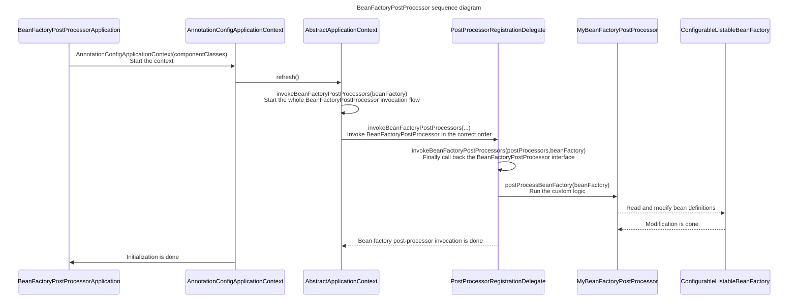

## BeanFactoryPostProcessor

- [BeanFactoryPostProcessor](#beanfactorypostprocessor)
  - [1. Overview](#1-overview)
  - [2. Interface Description](#2-interface-description)
  - [3. Interface Source](#3-interface-source)
  - [4. Main Features](#4-main-features)
  - [5. Best Practices](#5-best-practices)
  - [6. Sequence Diagram](#6-sequence-diagram)
  - [7. Source Code Analysis](#7-source-code-analysis)
  - [8. Notes](#8-notes)
  - [9. Summary](#9-summary)
    - [Best Practices Summary](#best-practices-summary)
    - [Source Code Analysis Summary](#source-code-analysis-summary)


### 1. Overview

✒️ **Author** - Lex 📝 **Blog** - [My CSDN](https://blog.csdn.net/duzhuang2399/article/details/133844965) 📚 **Contents** - [Source code](https://github.com/xuchengsheng/spring-reading) 🔗 **Source link** - [BeanFactoryPostProcessor source](https://github.com/xuchengsheng/spring-reading/tree/master/spring-interface/spring-interface-beanFactoryPostProcessor)

### 2. Interface Description

`BeanFactoryPostProcessor` is an interface. Any class that implements it must provide the `postProcessBeanFactory` method. This method gives you a chance to change bean definitions before the beans are instantiated.

### 3. Interface Source

`BeanFactoryPostProcessor` has been a core interface of the Spring Framework since 06.07.2003. It is a powerful way to change bean properties and dependencies. You can adjust these values dynamically based on specific configuration or environment conditions.

```java
/**
 * BeanFactoryPostProcessor is a core interface. It lets users change bean definitions
 * before the Spring container initializes the beans.
 * It is a powerful way to change bean properties and dependencies.
 * You can adjust these values dynamically based on specific configuration or environment conditions.
 * 
 * @author Juergen Hoeller
 * @author Sam Brannen
 * @since 06.07.2003
 * @see BeanPostProcessor
 * @see PropertyResourceConfigurer
 */
@FunctionalInterface
public interface BeanFactoryPostProcessor {

    /**
     * Modify the application context's internal bean factory after its standard
     * initialization. All bean definitions will have been loaded, but no beans
     * will have been instantiated yet. This allows for overriding or adding
     * properties even to eager-initializing beans.
     * 
     * @param beanFactory the bean factory used by the application context
     * @throws org.springframework.beans.BeansException in case of errors
     */
    void postProcessBeanFactory(ConfigurableListableBeanFactory beanFactory) throws BeansException;

}
```

### 4. Main Features

1. **Modify bean definitions**
   + `BeanFactoryPostProcessor` is called after Spring loads all bean definitions and before it starts to instantiate the beans. This means you can use it to change these bean definitions.

2. **Change property values**
   + You can change the properties or dependencies of a bean. This is very useful when you need to configure beans dynamically, for example based on the environment or other outside factors.

3. **Add or remove bean definitions**
   + You can change existing bean definitions. You can also add new bean definitions or remove existing ones.

4. **Apply several BeanFactoryPostProcessors**
   + If there are several `BeanFactoryPostProcessor` beans, you can control their execution order by implementing the `Ordered` interface.

### 5. Best Practices

First, look at the entry class. The context is `AnnotationConfigApplicationContext`, which configures the Spring container with Java annotations. We pass the `MyConfiguration` component class to its constructor. Then we call the `show()` method of `mySimpleBean1` and `mySimpleBean2`. This shows whether the scope of `MySimpleBean` is singleton or prototype. If both point to the same instance, it is a singleton. Otherwise, it is a prototype.

```java
public class BeanFactoryPostProcessorApplication {

    public static void main(String[] args) {
        AnnotationConfigApplicationContext context = new AnnotationConfigApplicationContext(MyConfiguration.class);

        MySimpleBean mySimpleBean1 = context.getBean(MySimpleBean.class);
        MySimpleBean mySimpleBean2 = context.getBean(MySimpleBean.class);

        mySimpleBean1.show();
        mySimpleBean2.show();
    }
}
```

We use the `@Bean` annotation to define two beans. This makes sure the Spring container handles both `MySimpleBean` and `MyBeanFactoryPostProcessor`.

```java
@Configuration
public class MyConfiguration {

    @Bean
    public MySimpleBean mySimpleBean(){
        return new MySimpleBean();
    }

    @Bean
    public static MyBeanFactoryPostProcessor myBeanFactoryPostProcessor(){
        return new MyBeanFactoryPostProcessor();
    }
}
```

When the `show` method of `MySimpleBean` is called, it prints "MySimpleBean instance" and the address of the current object (through `this`) to the console. This helps us see whether each call to get the bean returns the same instance (singleton) or a new one (prototype).

```java
public class MySimpleBean {

    public void show() {
        System.out.println("MySimpleBean instance: " + this);
    }
}
```

`MyBeanFactoryPostProcessor` is a simple implementation of `BeanFactoryPostProcessor`. When it is called, it gets the bean definition named `mySimpleBean` from `beanFactory`. By default, all beans are singletons. The class then changes the scope of `mySimpleBean` from singleton to prototype. In real projects, you can do more complex work inside `postProcessBeanFactory`. For example, you can change bean properties, wrap beans in a proxy to add features, change their scope, or add new bean definitions.

```java
public class MyBeanFactoryPostProcessor implements BeanFactoryPostProcessor {

    @Override
    public void postProcessBeanFactory(ConfigurableListableBeanFactory beanFactory) throws BeansException {
        System.out.println("Modify bean definition");
        BeanDefinition beanDefinition = beanFactory.getBeanDefinition("mySimpleBean");
        beanDefinition.setScope(BeanDefinition.SCOPE_PROTOTYPE);
        System.out.println("Changed mySimpleBean from the default singleton to prototype");
        System.out.println("Finished modifying bean definition");
    }
}
```

The output shows that `mySimpleBean` now has prototype scope. `[com.xcs.spring.config.MySimpleBean@11392934]` and `[com.xcs.spring.config.MySimpleBean@6892b3b6]` are two different addresses. So the two `MySimpleBean` instances are different.

```java
Modify bean definition
Changed mySimpleBean from the default singleton to prototype
Finished modifying bean definition
MySimpleBean instance: com.xcs.spring.config.MySimpleBean@11392934
MySimpleBean instance: com.xcs.spring.config.MySimpleBean@6892b3b6
```

### 6. Sequence Diagram



### 7. Source Code Analysis

First, look at the entry class. The context is `AnnotationConfigApplicationContext`, which configures the Spring container with Java annotations. We pass the `MyConfiguration` component class to its constructor. We get two instances of MySimpleBean from the Spring context and call the show method on both. If MySimpleBean is a singleton, the two instances are the same object. Otherwise, they are not.

```java
public class BeanFactoryPostProcessorApplication {

    public static void main(String[] args) {
        AnnotationConfigApplicationContext context = new AnnotationConfigApplicationContext(MyConfiguration.class);

        MySimpleBean mySimpleBean1 = context.getBean(MySimpleBean.class);
        MySimpleBean mySimpleBean2 = context.getBean(MySimpleBean.class);

        mySimpleBean1.show();
        mySimpleBean2.show();
    }
}
```

The constructor `org.springframework.context.annotation.AnnotationConfigApplicationContext#AnnotationConfigApplicationContext` runs three steps. We focus on the `refresh()` method.

```java
public AnnotationConfigApplicationContext(Class<?>... componentClasses) {
    this();
    register(componentClasses);
    refresh();
}
```

In the method `org.springframework.context.support.AbstractApplicationContext#refresh`, we focus on `invokeBeanFactoryPostProcessors(beanFactory)`. The other methods are not the focus of this article, so we skip them for now.

```java
@Override
public void refresh() throws BeansException, IllegalStateException {
     // ... [code omitted for brevity]
     // Invoke factory processors registered as beans in the context
     invokeBeanFactoryPostProcessors(beanFactory);
     // ... [code omitted for brevity]
}
```

The method `org.springframework.context.support.AbstractApplicationContext#invokeBeanFactoryPostProcessors` hands the work to `PostProcessorRegistrationDelegate.invokeBeanFactoryPostProcessors()`.

```java
protected void invokeBeanFactoryPostProcessors(ConfigurableListableBeanFactory beanFactory) {
    PostProcessorRegistrationDelegate.invokeBeanFactoryPostProcessors(beanFactory, getBeanFactoryPostProcessors());
    // ... [code omitted for brevity]
}
```

The method `org.springframework.context.support.PostProcessorRegistrationDelegate#invokeBeanFactoryPostProcessors` calls back the implementations of `BeanDefinitionRegistryPostProcessor` and `BeanFactoryPostProcessor`. Why is this method so long? Most of the code handles the execution order of the processors. First it calls the ones that implement `PriorityOrdered.class`. Then it calls the ones that implement `Ordered.class`. Last, it calls the ones that have no priority.

```java
public static void invokeBeanFactoryPostProcessors(
        ConfigurableListableBeanFactory beanFactory, List<BeanFactoryPostProcessor> beanFactoryPostProcessors) {

    // ... [code omitted for brevity]

    // Get the names of all beans that implement BeanFactoryPostProcessor.
    String[] postProcessorNames =
        beanFactory.getBeanNamesForType(BeanFactoryPostProcessor.class, true, false);

    // Create lists to separate the different kinds of BeanFactoryPostProcessors
    List<BeanFactoryPostProcessor> priorityOrderedPostProcessors = new ArrayList<>();
    List<String> orderedPostProcessorNames = new ArrayList<>();
    List<String> nonOrderedPostProcessorNames = new ArrayList<>();

    // Sort the BeanFactoryPostProcessors into the lists
    for (String ppName : postProcessorNames) {
        if (processedBeans.contains(ppName)) {
            // This bean was already processed, so skip it
        }
        else if (beanFactory.isTypeMatch(ppName, PriorityOrdered.class)) {
            // BeanFactoryPostProcessors with priority order
            priorityOrderedPostProcessors.add(beanFactory.getBean(ppName, BeanFactoryPostProcessor.class));
        }
        else if (beanFactory.isTypeMatch(ppName, Ordered.class)) {
            // BeanFactoryPostProcessors with order
            orderedPostProcessorNames.add(ppName);
        }
        else {
            // BeanFactoryPostProcessors without order
            nonOrderedPostProcessorNames.add(ppName);
        }
    }

    // Invoke the BeanFactoryPostProcessors that implement PriorityOrdered
    sortPostProcessors(priorityOrderedPostProcessors, beanFactory);
    invokeBeanFactoryPostProcessors(priorityOrderedPostProcessors, beanFactory);

    // Invoke the BeanFactoryPostProcessors that implement Ordered
    List<BeanFactoryPostProcessor> orderedPostProcessors = new ArrayList<>(orderedPostProcessorNames.size());
    for (String postProcessorName : orderedPostProcessorNames) {
        orderedPostProcessors.add(beanFactory.getBean(postProcessorName, BeanFactoryPostProcessor.class));
    }
    sortPostProcessors(orderedPostProcessors, beanFactory);
    invokeBeanFactoryPostProcessors(orderedPostProcessors, beanFactory);

    // Invoke all other BeanFactoryPostProcessors
    List<BeanFactoryPostProcessor> nonOrderedPostProcessors = new ArrayList<>(nonOrderedPostProcessorNames.size());
    for (String postProcessorName : nonOrderedPostProcessorNames) {
        nonOrderedPostProcessors.add(beanFactory.getBean(postProcessorName, BeanFactoryPostProcessor.class));
    }
    invokeBeanFactoryPostProcessors(nonOrderedPostProcessors, beanFactory);

    // Clear the metadata cache, because the BeanFactoryPostProcessors may have changed bean definitions
    beanFactory.clearMetadataCache();
}
```

Here is a sequence diagram I drew of the ordered callback process of `BeanFactoryPostProcessor`.

~~~mermaid
sequenceDiagram
    Title: BeanFactoryPostProcessor callback order sequence diagram
    participant Init as invokeBeanFactoryPostProcessors
    participant BFPP_PO as BFPP(PriorityOrdered)
    participant BFPP_O as BFPP(Ordered)
    participant BFPP as Other BFPP

    Init->>BFPP_PO: Callback
    BFPP_PO-->>Init: Done
    Init->>BFPP_O: Callback
    BFPP_O-->>Init: Done
    Init->>BFPP: Callback
    BFPP-->>Init: Done
    
    Note right of BFPP: Tip: 
    Note right of BFPP: BFPP = BeanFactoryPostProcessor

~~~

The method `org.springframework.context.support.PostProcessorRegistrationDelegate#invokeBeanFactoryPostProcessors` loops over the processors and calls `postProcessBeanFactory(registry)` from the `BeanFactoryPostProcessor` interface.

```java
private static void invokeBeanFactoryPostProcessors(
			Collection<? extends BeanFactoryPostProcessor> postProcessors, ConfigurableListableBeanFactory beanFactory) {

    for (BeanFactoryPostProcessor postProcessor : postProcessors) {
        StartupStep postProcessBeanFactory = beanFactory.getApplicationStartup().start("spring.context.bean-factory.post-process")
            .tag("postProcessor", postProcessor::toString);
        postProcessor.postProcessBeanFactory(beanFactory);
        postProcessBeanFactory.end();
    }
}
```

Finally, the call reaches our own logic. In real projects, you can do more complex work inside `postProcessBeanFactory`. For example, you can change bean properties, wrap beans in a proxy to add features, change their scope, or add new bean definitions.

```java
public class MyBeanFactoryPostProcessor implements BeanFactoryPostProcessor {

    @Override
    public void postProcessBeanFactory(ConfigurableListableBeanFactory beanFactory) throws BeansException {
        System.out.println("Modify bean definition");
        BeanDefinition beanDefinition = beanFactory.getBeanDefinition("mySimpleBean");
        beanDefinition.setScope(BeanDefinition.SCOPE_PROTOTYPE);
        System.out.println("Changed mySimpleBean from the default singleton to prototype");
        System.out.println("Finished modifying bean definition");
    }
}
```

### 8. Notes

1. **Consider other `BeanFactoryPostProcessor` beans**
   + In large applications, there may be many `BeanFactoryPostProcessor` beans. Make sure they do not conflict with each other or produce inconsistent bean definitions.

2. **Watch the execution order**
   + If there are several `BeanFactoryPostProcessor` beans, their order can change the result. Use the `Ordered` or `PriorityOrdered` interface to set the order explicitly.

3. **Avoid circular dependencies**
   + Changing bean definitions can introduce circular dependencies. Make sure you understand the dependencies between beans, and try not to change them. For example, changing the constructor in a `BeanDefinition` can introduce a circular dependency.

4. **Do not overuse it**
   + `BeanFactoryPostProcessor` is a very powerful interface, but that does not mean you should use it often. Use it only when you really need it. Also check whether a simpler and more direct way can reach the same goal.

5. **Use it with care**
   + `BeanFactoryPostProcessor` lets you change bean definitions. This means you can change the class, scope, properties, and more of a bean. Be very careful when you do this. Ask why you need the change and how far its effect reaches. This helps you avoid inconsistent or unpredictable behavior.

### 9. Summary

#### Best Practices Summary

1. **Initialization and configuration**
   + With `AnnotationConfigApplicationContext`, we started the Spring container and loaded the `MyConfiguration` configuration. In `MyConfiguration`, we defined two core beans: `MySimpleBean` and `MyBeanFactoryPostProcessor`.

2. **Change the bean scope**
   + `MySimpleBean` is a singleton by default. With `MyBeanFactoryPostProcessor`, we changed this default and made it a prototype. We did this by overriding the `postProcessBeanFactory` method and changing the bean definition of `mySimpleBean`.

3. **Verify the change**
   + We got two instances of `MySimpleBean` in the main application and called their `show` method. The printed instance addresses show that the two beans are different instances.

#### Source Code Analysis Summary

1. **Startup and context**
   + We used `AnnotationConfigApplicationContext` to create the Spring container and loaded `MyConfiguration` as the main configuration.

2. **Core call**
   + In the `refresh` method of the Spring container, `invokeBeanFactoryPostProcessors(beanFactory)` makes sure all `BeanFactoryPostProcessor` beans are called properly.

3. **Callback order**
   + In Spring, beans that implement `BeanFactoryPostProcessor` are not called at random. Spring sorts them into `PriorityOrdered`, `Ordered`, and non-ordered groups and calls them in that order.

4. **Custom logic**
   + When we implement the `BeanFactoryPostProcessor` interface and add custom logic (for example, changing the scope of a bean), that logic is called at the right stage of the process above.

5. **Practical example**
   + The example shows how to use `BeanFactoryPostProcessor` to change a bean definition before the bean is instantiated. In our example, the scope of `MySimpleBean` is changed from singleton to prototype.
